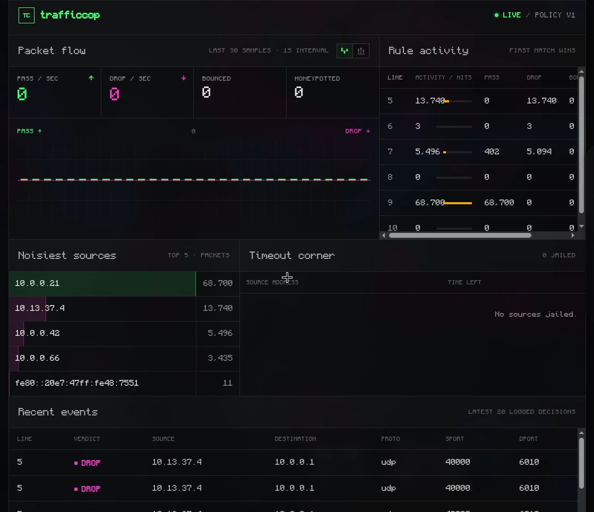

# trafficoop

[](https://github.com/Anirban-Majumder/trafficoop/actions/workflows/checks.yml)

A single-binary XDP/eBPF firewall. Every packet verdict — parsing, first-match
rules, address sets, per-source rate limits, port-scan jails, counters and
events — happens in XDP, in C, right at the driver. Go (with cilium/ebpf)
handles configuration, atomic reloads, IPC and telemetry, and serves an
embedded dashboard. No iptables, no nftables, no tc.



I started this because I wanted to actually understand XDP: what a packet
verdict looks like when you write it yourself in C, how to swap a live program
under traffic without dropping a frame, and what the honest numbers are once
you measure instead of guess. It turned into a complete firewall with a
daemon, a CLI and an operations-console dashboard, and it taught me more about
the kernel than any tutorial I've read.

## Features

- **All verdicts in XDP** — bounded, verifier-safe C parses 802.1Q tags,
  IPv4 options and bounded IPv6 extension chains, then applies first-match
  policy. Go never decides a packet.
- **Atomic reloads** — each reload builds a complete, immutable policy
  generation, freezes a private config map and updates the existing
  `bpf_link` in place. A failed candidate closes its own resources; the old
  program keeps serving traffic the whole time.
- **Jails and port-scan detection** — offending sources get timed out in a
  kernel state map; scan-window thresholds survive reloads and contention.
- **Per-rule rate limits** — independent 65,536-source LRU maps per rule,
  shared across CPUs, with off-packet reclamation of expired state.
- **Live address sets** — `set add`/`set del` operate directly on BPF maps,
  without rewriting the rules file or resetting counters.
- **One honest telemetry path** — the CLI and `/stats.json`, `/jail.json`,
  `/log.json` share one typed snapshot implementation, so the dashboard shows
  exactly what the CLI shows. `/health.json` reports allocation/ring/stream
  failures separately.
- **Embedded dashboard** — a dark, hairline-framed operations console with a
  locally bundled pixel font, embedded in the binary, no external assets.

## Quickstart

On Ubuntu 24.04 with root/sudo and network access:

```sh
./build.sh --install-deps
```

The script installs clang, llvm, libbpf-dev, linux-libc-dev, gcc, make,
golang-go, iproute2, python3, ca-certificates and git, then compiles
`./trafficoop`. Go 1.22+ is required; dependencies are pinned in
go.mod/go.sum. Subsequent builds use `./build.sh`. The daemon needs root,
BPF/network-admin capabilities, and a kernel with native XDP/`bpf_link`
support — there is no silent generic-mode fallback. No CGO or external object
file is needed at runtime: cilium/ebpf loads the embedded BPF object, and
libbpf is only a build-time header dependency. Development target: x86-64
Ubuntu 24.04 / Linux 6.8, four CPUs.

The easiest way to see it work is the self-contained demo, which creates its
own namespace and veth pair:

```sh
sudo ./demo.sh start
sudo ./demo.sh dashboard   # then open http://127.0.0.1:8088/
```

The dashboard proxy is a foreground localhost process (Python stdlib) that
forwards live telemetry JSON into the namespace; Ctrl+C stops the proxy but
leaves the demo running. Frontend edits in `internal/observe/web/` appear on a
browser refresh without rebuilding; Go or BPF changes still require
`./build.sh` and a demo restart. Generate illustrated traffic with:

```sh
sudo nsenter --net=/run/netns/trafficoop-demo python3 tests/bench/demo_traffic.py
```

When finished, `sudo ./demo.sh stop` removes the owned namespace and stops its
daemon. Repeated stop is harmless; failed startup rolls back everything it
created.

## Architecture

One executable contains the compiled BPF object and all web assets. The
long-lived daemon owns the XDP link, maps, event consumer, localhost HTTP
server and Unix control socket; short-lived CLI processes send control
requests over a mode-0600 socket, serialized by an advisory lock. No maps are
pinned.

- **XDP dataplane (C)** — first-match policy, mixed-family address sets,
  per-source limit buckets, jail and port-scan state, per-CPU counters and an
  event ring.
- **Control plane (Go)** — strict rules-file grammar, immutable policy
  generations, map/link lifecycle and live commands.
- **Observability (Go)** — a dedicated event drain retains the newest 1,000
  decisions across reloads; snapshots are safe for concurrent CLI/HTTP use
  and detached from mutable storage.

Details, invariants and the reasoning behind each choice live in
[architecture.md](architecture.md).

## CLI

Inside your dedicated network namespace:

```sh
./trafficoop start eth0 demo.rules hp0   # optional hp0 honeypot interface
./trafficoop reload demo-next.rules
./trafficoop set add cheaters 2001:db8:bad::/48
./trafficoop set del cheaters 10.0.0.7/32
./trafficoop stats
./trafficoop jail
./trafficoop unjail 2001:db8::7
./trafficoop log
./trafficoop stop
```

Rules implement the full action/condition set: mixed-family prefixes/sets,
first-match ordering, VLAN/options/fragments and bounded IPv6 extension
chains. Persistent counters, jail records and log history survive reloads;
sets and per-rule counters are replaced. Immutable per-generation feature
masks prune unused verifier paths without stretching the one-second reload
budget or disabling configured rules.

Runtime policy files must be regular files or `/dev/null`, at most 16 MiB
including comments; FIFOs/devices are rejected before opening for reads.
Finite state limits and platform gaps are documented in
[integration validation](docs/integration-validation.md).

## Dashboard

The embedded dashboard is a dark, hairline-framed operations console using the
locally bundled Monocraft pixel font (OFL; see
`internal/observe/web/fonts/OFL.txt`). It refreshes every second from the same
read-only endpoints as the CLI and makes no external asset requests. The
HTML, CSS, JavaScript and fonts are embedded in the Go binary and served
under the existing CSP.

- **Packet flow** — pass/drop rates from cumulative counter deltas over a
  30-sample, one-second window, with a toggle between a zero-center diverging
  chart and stacked pass/drop bars.
- **Rule activity** — first-match policy order, exact hits, verdict splits
  and a compact hit bar.
- **Noisiest sources** — the top five source addresses with normalized packet
  bars and exact counts.
- **Timeout corner** and **Recent events** — current jail entries with
  remaining time, and the latest 20 logged decisions with verdict and packet
  fields.
- **System telemetry** — malformed, non-IP, jail-drop, default-hit,
  address-set and event-loss counters; `/health.json` failures raise a
  visible warning.

## Tests

```sh
make test
make integration
make stress
make endurance  # five-minute reload/set/maximum-policy resource check
make throughput # four-CPU private-veth flood; not physical-NIC line rate
make capacity   # full-map CLI timing check (exposes a million-entry jail timeout)
```

Dataplane-specific tests:

```sh
bash bpf/test.sh                # exact short parser fixtures, ASan/UBSan
sudo bash bpf/test.sh --kernel  # actual BPF packet/state/ABI/four-CPU tests
sudo bash bpf/netns-test.sh     # private veth wire actions/replacement under load
```

Integration/stress tests create private namespaces/veths and attempt cleanup
on every exit. They refuse an existing daemon, and none of them replace a
host attachment — do not attach this to a production interface without
verifying it on the target platform first.

## Validation evidence

See [integration validation](docs/integration-validation.md),
[kernel validation](docs/dataplane-validation.md) and
[bootstrap validation](docs/bootstrap-validation.md). Measured daemon logging:
90,000 decisions in 3.601 s (~24,997/s), zero loss, exact last-1,000 history
under concurrent/slow HTTP clients. These are local measurements, not a
flood/NIC throughput ranking or a Linux 6.8 guarantee. CI runs the expanded
smoke suite on Ubuntu 24.04; inspect its result after publishing rather than
assuming it passed.

Developed on Ubuntu 24.04 / WSL (Linux 6.18). The full acceptance suite,
`tests/integration/acceptance.sh`, targets a native Ubuntu 24.04 x86-64 host
running Linux 6.8 with at least four allowed CPUs, and that run is still
unverified — see [the implementation checklist](docs/spec-checklist.md) for
exactly what has been measured and what hasn't.

## Contributing

PRs are welcome. The original build was tracked in three areas — dataplane,
control plane, observability — and the
[issue tracker](https://github.com/Anirban-Majumder/trafficoop/issues) has the
history.

```sh
git fetch origin
git switch -c feat/<area> origin/main
# implement your change
./build.sh
make test
sudo tests/integration/bootstrap.sh
git add <your-files>
git commit -m "Describe the problem and resulting behavior"
git push -u origin feat/<area>
gh pr create --base main --head feat/<area> --title "Concrete behavior" --body-file /tmp/pr.md
```

In `/tmp/pr.md`, explain behavior, list checks actually run, and disclose
missing checks/limitations. Keep shared-ABI changes small. Merge green,
reviewed PRs frequently; update your branch from main before integrating.

## Project docs

- [Architecture](architecture.md) — design, invariants and decision history
- [ABI notes](docs/dataplane-abi.md) — C ABI v6, publication and lifetime rules
- [Implementation checklist](docs/spec-checklist.md) — feature-by-feature status
- [Contributor instructions](AGENTS.md) — layout, ownership and workflow rules
